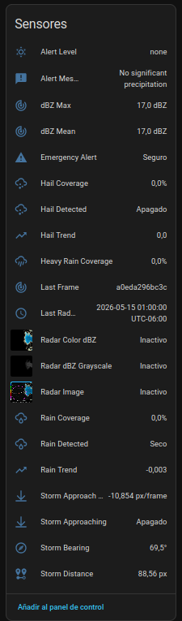
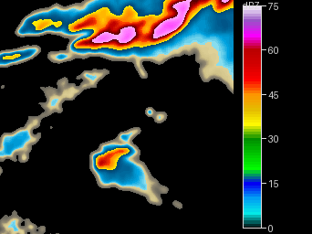
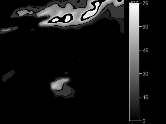
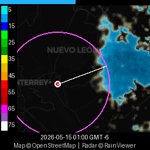

# 🌧 Radar Storm Detector — Home Assistant Integration

[](https://github.com/hacs/integration)
[](https://github.com/miplatas/time-spent-pie-card/releases)
[](https://github.com/miplatas/time-spent-pie-card/commits/main)
[](https://ko-fi.com/miplatas)

A Home Assistant integration that detects storm conditions using **RainViewer** radar images and automatically publishes data to **MQTT**.

---

## ⚠️ Disclaimer

> **IMPORTANT:** This integration is an informational tool and is **NOT** an official early warning safety device or a life-safety critical system. Precipitation data and estimated storm metrics rely on third-party radar imagery and automated heuristic calculations. Do not rely exclusively on this integration for personal safety, disaster preparedness, or severe weather emergencies. Always follow instructions and official warnings issued by your local government meteorological agencies and emergency services.

## ✨ Capabilities & Limitations

### ✅ What it CAN do:
* 📡 **Analyze Radar Tiles:** Fetch and process real-time radar imagery via the free RainViewer API (no API key required) using automated XYZ tile coordinates.
* 🧭 **Estimate Proximity & Direction:** Calculate storm cover percentage, core distance, direction (bearing), radial approach velocity, and render diagnostic proximity circles.
* 🗺️ **Generate Multi-Layer Visuals:** Produce static PNGs and animated GIF camera entities over Day, Night, or Satellite base maps with rolling buffer history and customizable timezone footers.
* 📊 **Expose Rich Entities:** Automatically create 14 state sensors, 4 binary sensors, and 3 cameras in Home Assistant without editing YAML files.
* ⚡ **Trigger Automations:** Automatically create state and binary sensors (rain, heavy rain, hail, approach status) to trigger Home Assistant automations and scripts.
* 📨 **Publish to MQTT:** Publish full diagnostic payloads (dBZ values, coverage percentages, proximity metrics) to local or remote MQTT brokers.
* 🔧 **Live UI Configuration:** Adjust scan intervals, thresholds, alert radiuses, and map settings via the UI for personalized use.

### ❌ What it CANNOT do:
* 📢 **Replace Official Weather Warnings:** Issue certified, legally recognized severe weather alerts or replace local emergency broadcasting systems.
* 🎯 **Guarantee Automated Accuracy Independently:** Sensor accuracy (such as `rain_detected` or `hail_detected`) is directly dependent on user-predefined triggers and thresholds (e.g., `Rain threshold`, `Hail threshold`, `Alert distance`) relative to the total analyzed radar tile coverage area and zoom level.
* ⏱️ **Guarantee Real-time Precision:** Account for third-party radar upload delays, radar beam shadowing, ground clutter, or scan frequency gaps inherent to public radar feeds.
* 🏠 **Predict Micro-scale Downpours:** Guarantee rain at an exact house roof level, as radar measures atmospheric reflectivity aloft, not ground-level rain gauges.
* 🌐 **Operate Offline:** Function without an active internet connection, as downloading radar frames and base map tiles requires online access.

## 🖼️ Image examples

These images are included in the repository as visual references for the integration:

| File | Description | Preview |
|---|---|---|
| `images/sensors.png` | Example of the Home Assistant sensors created by the integration. |  |
| `images/radar_RGBA_in.png` | Raw radar image in RGBA format before processing. |  |
| `images/radar_dbz_out.png` | Example of the radar processing output with an approximate dBZ result. |  |
| `images/radar_data_final.jpg` | Final composed radar image used as the finished reference. |  |

## 🌍 XYZ Tile Format

This application utilizes the **XYZ tile format**, more commonly known as the **Slippy Map** coordinate system. It is the standard format used by OpenStreetMap, Google Maps, and most other web mapping platforms.

The structure of the URL always follows this pattern:
`.../{z}/{x}/{y}.png`

### Example: Northeast Mexico
**URL:** [https://a.tile.openstreetmap.org/7/28/54.png](https://a.tile.openstreetmap.org/7/28/54.png)

In this specific example (`7/28/54.png`), the coordinates break down as follows:

* **7 (z - Zoom Level):** The level of detail. Zoom level `0` shows the entire world on a single tile, while zoom level `7` shows a regional view (e.g., a country or large state).
* **28 (x - Column):** The horizontal coordinate. The grid starts at `0` at the western edge of the map (180° W) and increases moving East.
* **54 (y - Row):** The vertical coordinate. The grid starts at `0` at the northern edge of the map (85.0511° N) and increases moving South.

> [!TIP]
> Before completing your configuration, please verify that your specific `{z}/{x}/{y}` coordinates reflect the correct location by testing the URL `https://a.tile.openstreetmap.org/{z}/{x}/{y}.png` in your browser for a given `x`, `y`, `z`.

---

## 📦 Installation via HACS

### Recommended method

1. In Home Assistant, go to **HACS → Integrations → ⋮ → Custom repositories**
2. Add the URL: `https://github.com/miplatas/radar-storm-detector`
3. Category: **Integration**
4. Search for **Radar Storm Detector** and click **Download**
5. Restart Home Assistant

### Manual method

1. Copy the `custom_components/radar_storm_detector` folder to your `config/custom_components/` directory
2. Restart Home Assistant

---

## ⚙️ Configuration

1. Go to **Settings → Devices & Services → Add Integration**
2. Search for **Radar Storm Detector**
3. Fill in the form:

| Field | Description | Default |
|---|---|---|
| Latitude | Your location latitude | HA location |
| Longitude | Your location longitude | HA location |
| Zoom | Radar zoom level (1–7) | 7 |
| Tile X | Radar tile X (auto-calculated from lat/lon/zoom) | auto |
| Tile Y | Radar tile Y (auto-calculated from lat/lon/zoom) | auto |
| MQTT Broker | Broker IP or hostname | — |
| MQTT Port | Broker port (1–65535) | 1883 |
| MQTT Username | (optional) | — |
| MQTT Password | (optional) | — |
| Rain threshold | Minimum pixel fraction for rain (0.0–1.0) | 0.005 |
| Hail threshold | Minimum pixel fraction for hail (0.0–1.0) | 0.001 |
| Alert distance | Maximum distance in kilometers for alert (1–1000) | 30 |
| GIF speed (ms) | Milliseconds per frame in the animated camera (100–5000) | 500 |
| Map style | Base map: `day`, `night`, or `satellite` | day |
| Timezone | Display timezone for the camera footer (GMT −12 to GMT +14) | GMT −6 |
| Proximity circles | Draw diagnostic circles centered on your home marker to visualize distance bands used for storm proximity and bearing checks on the radar image | on |

The radar data is checked every 600 seconds. This interval is fixed and is not configurable. Other options can be updated at any time from **Settings → Devices & Services → Radar Storm Detector → Configure** without restarting Home Assistant.

---

## 🌡 Sensors created automatically

### State sensors (`sensor.*`)

| Entity | Description | Unit | Extra attributes |
|---|---|---|---|
| `sensor.radar_storm_detector_alert_level` | Alert level: `none` / `watch` / `warning` / `emergency` | — | `alert_message`, `approaching` |
| `sensor.radar_storm_detector_alert_message` | Human-readable alert description | — | — |
| `sensor.radar_storm_detector_rain_coverage` | % of pixels with rain (light + moderate) | % | — |
| `sensor.radar_storm_detector_heavy_rain_coverage` | % of pixels with heavy rain | % | — |
| `sensor.radar_storm_detector_hail_coverage` | % of pixels with hail | % | — |
| `sensor.radar_storm_detector_rain_trend` | Rain trend between frames (positive = increasing) | % | — |
| `sensor.radar_storm_detector_hail_trend` | Hail trend between frames | % | — |
| `sensor.radar_storm_detector_storm_distance` | Mean distance to nearest precipitation (km) | km | `bearing`, `dist_max`, `approach_vel`, `core_growth`, `approaching` |
| `sensor.radar_storm_detector_dbz_mean` | Mean dBZ of the latest frame | dBZ | — |
| `sensor.radar_storm_detector_dbz_max` | Max dBZ of the latest frame | dBZ | — |
| `sensor.radar_storm_detector_storm_approach_velocity` | Radial velocity toward home (km/h; negative = approaching) | km/h | — |
| `sensor.radar_storm_detector_storm_bearing` | Compass bearing to nearest storm (0 = N, 90 = E, 180 = S, 270 = W) | ° | — |
| `sensor.radar_storm_detector_last_radar_image_url` | Last Radar Storm Detector frame ID (for example `c9c58489641f`) | — | `frame_id`, `url`, `image_url` |
| `sensor.radar_storm_detector_last_radar_time` | Timestamp of the last radar frame (localized) | — | — |

### Cameras (`camera.*`)

| Entity | Description |
|---|---|
| `camera.radar_storm_detector_radar_image` | **Animated GIF**: OSM/Night/Satellite map + radar overlay + home marker centered in the image + proximity circles (distance bands around home, enabled by default, useful to verify proximity and bearing logic) + dBZ legend + timestamp footer. Buffers the last 6 analyzed frames. Attributes: `history` (list of timestamps + URLs), `frames_in_buffer`. |
| `camera.radar_storm_detector_radar_color_dbz` | **Static PNG**: Latest raw radar tile in original Radar Storm Detector colors with a dBZ scale bar on the right. |
| `camera.radar_storm_detector_radar_dbz_grayscale` | **Static PNG**: Latest radar tile converted to grayscale proportional to dBZ intensity, with a grayscale dBZ scale bar on the right. |

Proximity circles legend on the animated GIF:
- Blue/cyan circle: radius based on `dist_mean` (reported in km, rendered on map in pixels), showing the distance to the nearest representative precipitation area (pixels with dBZ greater than or equal to the current mean dBZ).
- Purple circle: radius based on `dist_max` (reported in km, rendered on map in pixels), showing the distance to the nearest strongest precipitation core (pixels with dBZ greater than or equal to the current max dBZ).
- White line: `bearing_mean` direction from your home marker to the nearest representative storm area.

### Binary sensors (`binary_sensor.*`)

| Entity | Description |
|---|---|
| `binary_sensor.radar_storm_detector_rain_detected` | `on` when alert level is `watch`, `warning`, or `emergency` |
| `binary_sensor.radar_storm_detector_hail_detected` | `on` when hail pixel fraction > 0.001. Attribute: `hail_coverage_pct` |
| `binary_sensor.radar_storm_detector_storm_approaching` | `on` when the storm is moving toward your location |
| `binary_sensor.radar_storm_detector_emergency_alert` | `on` on emergency alert |

---

## 📨 MQTT Topics

| Topic | When published |
|---|---|
| `radar_storm_detector/status` | Every analysis cycle |
| `radar_storm_detector/alert` | Only when `alert != "none"` |

### Example JSON payload

```json
{
  "timestamp": 1746100000,
  "location": {"lat": 19.4326, "lon": -99.1332},
  "alert": "warning",
  "alert_msg": "Heavy rain approaching",
  "last_radar_url": "https://tilecache.rainviewer.com/.../256/7/28/54/8/1_1.png",
  "last_radar_time": "2025-05-01 14:30:00 GMT -6",
  "current": {"rain": 0.012, "hail": 0.002, "heavy": 0.008},
  "trend": {"rain": 0.003, "hail": 0.001},
  "proximity": {
    "dist_mean": 22.5,
    "dist_max": 18.0,
    "bearing_mean": 75.3,
    "approach_vel": -1.2,
    "core_growth": 0.4,
    "approaching": true
  },
  "frames": [...]
}
```

---

## 🔔 Automation example

```yaml
automation:
  - alias: "Storm Alert"
    trigger:
      - platform: state
        entity_id: binary_sensor.radar_storm_detector_emergency_alert
        to: "on"
    action:
      - service: notify.mobile_app
        data:
          title: "⚠️ Storm Warning"
          message: "{{ states('sensor.radar_storm_detector_alert_message') }}"
```

---

## 📝 Alert levels

Radar intensity is estimated from RainViewer pixel colors using the integration's dBZ lookup table. Approximate pixel classes are:

| Radar class | Estimated intensity |
|---|---|
| Light | 15 to <30 dBZ |
| Rain | 30 to <45 dBZ |
| Heavy | 45 to <55 dBZ |
| Hail | ≥55 dBZ (with an additional color-based hail heuristic) |

Alerts are based on the fraction of pixels in the latest analyzed radar tile, not on a single pixel's dBZ alone:

| Level | Condition |
|---|---|
| `none` | Rain-plus-heavy coverage is at or below the rain threshold, and hail coverage is at or below the hail threshold. |
| `watch` | Hail is below its threshold and either rain-plus-heavy coverage exceeds the rain threshold while heavy-rain coverage does not, or heavy-rain coverage exceeds the rain threshold but the representative precipitation area is not within the alert distance. |
| `warning` | Hail coverage exceeds the hail threshold but the representative precipitation area is not within the alert distance; or heavy-rain coverage exceeds the rain threshold and that area is within the alert distance. |
| `emergency` | Hail coverage exceeds the hail threshold and the representative precipitation area is within the alert distance. |

Defaults are a **0.5%** rain threshold, **0.1%** hail threshold, and **30 km** alert distance. These thresholds can be changed in the integration options. The rain threshold is applied to rain-plus-heavy coverage and separately to heavy-rain coverage; the hail threshold applies to hail coverage. The distance comparison is strict (`<`): a storm exactly at the configured distance is treated as outside it.

The distance used to choose between regional and nearby alert levels is measured to the nearest pixel in the representative precipitation area (pixels at or above the mean dBZ of detected precipitation). It is not necessarily the distance to the nearest hail or heavy-rain pixel specifically. `watch`/`warning`/`emergency` are heuristic levels from radar imagery, not official weather warnings.

---

## 🗺️ Map styles

| Style | Tile source |
|---|---|
| `day` | OpenStreetMap (standard) |
| `night` | [Mella Basemap](https://basemap.queeniemella.cc/) (OpenStreetMap) |
| `satellite` | ArcGIS World Imagery |

The night map displays attribution to queeniemella and OpenStreetMap contributors.

---

## 🛠 Dependencies

The following libraries are installed automatically:
- `requests`
- `Pillow`
- `numpy`
- `paho-mqtt`

---

## 📄 License

GNU GENERAL PUBLIC LICENSE Version 3. — see [LICENSE](LICENSE)
